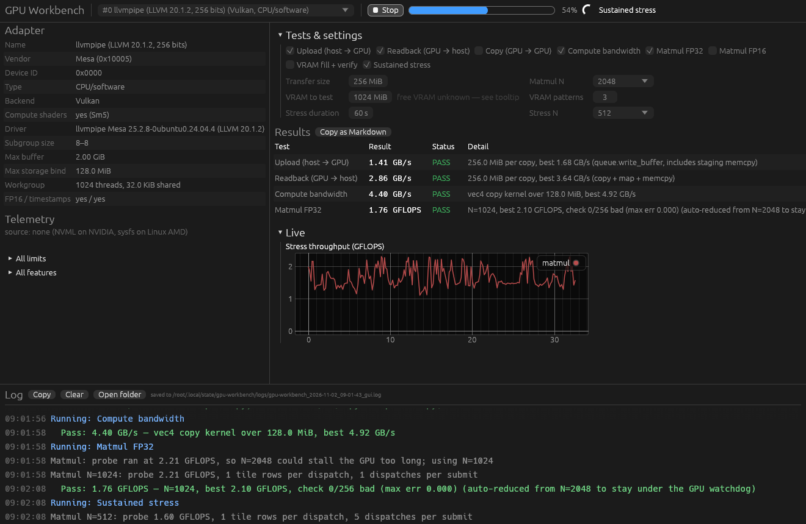

# GPU Workbench

A desktop app for checking what a GPU is, how fast it moves and computes
data, and whether it stays correct under load. Runs on **Windows and Linux**,
with a GUI or headless (`gpu-workbench-cli`).

Built in Rust on [wgpu](https://wgpu.rs) and [egui](https://github.com/emilk/egui):
Vulkan and DX12 for modern cards, OpenGL 4.3 as a fallback for older ones. It
works across NVIDIA, AMD and Intel and needs no CUDA or ROCm, so it runs on
GPUs that are too old for CUDA.



## Features

- **Adapter info** for every GPU and backend: vendor, driver, PCI bus, limits,
  FP16/timestamp support, full limits and feature lists.
- **Live sensors** (NVIDIA via NVML, AMD on Linux via sysfs): temperature,
  power, clocks, utilization, VRAM used, fan, plotted over time.
- **Benchmarks**: host↔GPU transfer, GPU copy, shader memory bandwidth,
  FP32/FP16 matrix multiply with a CPU correctness check.
- **VRAM fill + verify**: writes and checks a pattern across (almost) all
  video memory, with several patterns, and flags memory the driver quietly put
  in system RAM.
- **Sustained stress**: runs matmul for minutes, plots throughput live, and
  reports start-vs-end speed so thermal or power throttling shows up.
- **Safe on old GPUs**: work is split so nothing hits the 2-second Windows
  GPU watchdog; driver resets are reported instead of crashing the run.
- **Logs to disk** every session, flushed line by line, including crashes.

## Download

Prebuilt binaries are attached to each
[GitHub Release](../../releases) (Windows `.zip`, Linux `.tar.gz`), and every
push builds them as CI artifacts under the **Actions** tab.

## Build from source

Needs Rust 1.95 or newer (`rustup update`).

**Windows:** install the Visual Studio C++ build tools first, then build from
PowerShell or cmd (not Git Bash, whose own `link` command shadows the MSVC linker):

```powershell
winget install Microsoft.VisualStudio.2022.BuildTools --override "--wait --passive --add Microsoft.VisualStudio.Workload.VCTools --includeRecommended"
```

**Linux** (Debian/Ubuntu shown): a GPU driver with Vulkan or OpenGL, and the
windowing libraries:

```sh
sudo apt install mesa-vulkan-drivers libegl1 libgl1-mesa-dri \
                 libxkbcommon-x11-0 libxcursor1 libxi6 libxrandr2
```

(NVIDIA users: the proprietary driver provides Vulkan, OpenGL and NVML.)

Then:

```sh
cargo run --release                                    # GUI
cargo run --release --bin gpu-workbench-cli -- --list         # list adapters and exit
cargo run --release --bin gpu-workbench-cli                   # quick suite, headless
cargo run --release --bin gpu-workbench-cli -- --tests all --stress-secs 300
cargo run --release --bin gpu-workbench-cli -- --help         # options, plus what each test does
```

## Usage

Hover over any test or setting in the GUI for an explanation of what it does
and what values make sense.

**GUI.** Pick a GPU from the dropdown (the same card often appears once per
backend, e.g. Vulkan and DX12, which is useful for comparing drivers). Tick
tests, adjust sizes, press **Run selected**, or **Quick suite** for the fast
tests. Results fill the table, sensors and stress throughput plot under
**Live**, and the log panel along the bottom follows activity as it happens
(scroll up to pause it, scroll back down to resume).

**CLI.** `gpu-workbench-cli` runs the same tests in a terminal and exits
non-zero if any test fails or the run can't start, so it can be scripted from
PowerShell, cmd or bash. Numbers outside the ranges below are refused with exit
code 2 and a message naming the option, rather than replaced by a default.

```
--adapter N        adapter index from --list (default: best GPU found)
--tests LIST       upload,readback,copy,bandwidth,matmul32,matmul16,vram,stress
                   or quick | all  (default: quick)
--transfer-mb N    buffer size for transfer tests, 16-4096 (default 256)
--matmul-n N       matrix size, 256-8192 and a multiple of 64 (default 2048)
--vram-mb N        VRAM to fill and verify (default: auto, 90% of free VRAM
                   measured when the test starts, else 1024)
--vram-passes N    patterns per VRAM run, 1-6 (default 3)
--stress-secs N    stress duration in seconds, 5-3600 (default 60)
--stress-n N       matrix size for the stress test, 256-8192 and a multiple
                   of 64 (default 2048)
```

On Windows, `gpu-workbench.exe` is a GUI program with no console window, so
PowerShell doesn't wait for it and doesn't set `$LASTEXITCODE`. For the command
line use `gpu-workbench-cli.exe`, which is a console program: output goes to
the terminal and the exit code works in scripts. (`gpu-workbench.exe --cli`
still works from cmd.)

**Environment variables**

| Variable | Effect |
|---|---|
| `WGPU_BACKEND=vulkan,dx12,gl` | only use these backends |
| `WGPU_DX12_COMPILER=fxc\|dxc` | force the DX12 shader compiler (see DX12 shader compiler) |
| `WORKBENCH_RENDERER=glow\|wgpu` | how the window itself is drawn (see Older GPUs) |
| `WORKBENCH_THEME=light\|dark` | override the OS theme |

## Tests

| Test | What it measures |
|---|---|
| Upload | host → GPU through `queue.write_buffer` (includes wgpu's staging copy) |
| Readback | GPU → host: copy to a mappable buffer, map, memcpy |
| Copy | GPU → GPU buffer copy; read + write both counted |
| Compute bandwidth | vec4 copy shader: effective VRAM bandwidth from a kernel |
| Matmul FP32 / FP16 | tiled 64×64 matrix multiply in GFLOPS; 256 sampled entries checked against the CPU |
| VRAM fill + verify | allocates up to the target in 256 MiB chunks, fills all of it with a hashed pattern, then checks every word; repeats with new patterns |
| Sustained stress | back-to-back matmul for N seconds; live GFLOPS plot, start vs end throughput, result re-checked at the end |

### Reading the results

- **These are numbers achievable through wgpu.** Hand-tuned CUDA/ROCm code
  beats the matmul, often by 2–5×. Bandwidth tests usually land at 70–90% of
  the card's spec.
- **Matmul correctness is exact.** Inputs are multiples of 0.25, so every FP32
  product and sum is exactly representable: any mismatch with the CPU is a
  real error, not rounding.
- **Watchdog protection.** Before each matmul, a tiny 256×256 run measures
  speed; the real one is then split into ~30 ms pieces. If the requested size
  would still be risky, N is reduced and the result says
  "auto-reduced from N=…". If the driver resets the GPU anyway ("device
  lost"), the run stops with a message.
- **Small sizes measure overhead.** Keep transfers at 256 MiB or more and N at
  2048 or more for meaningful numbers.

### VRAM test: what to set

Leave **Auto** on (the default). When the VRAM test starts, it measures free
memory right then and uses 90% of it:

- **Windows:** the VRAM *budget* Windows grants this app (DXGI). This is the
  most accurate limit: it is how much the app can keep in VRAM before Windows
  starts moving its memory to system RAM.
- **Elsewhere:** free VRAM from the sensors (NVIDIA NVML, AMD sysfs).
- **Neither available:** 1 GiB.

When both a DXGI budget and a sensor reading exist, the smaller one is used.
The log shows every figure and which one was chosen.

To pick a size yourself, untick Auto (or pass `--vram-mb`). Aim for about
85–90% of the card's free VRAM; "Max buffer" doesn't matter, since the test
allocates about 32 chunks.

**Spillover detection.** Asking for more than is free usually doesn't fail:
Windows (DX12 especially) quietly places the excess in system RAM, and Vulkan
either does the same or reports "Out of Memory", in which case the test runs
on what it got. Two checks catch spillover:

1. Every chunk is timed. Chunks filling at under 40% of the fastest chunk's
   speed are re-timed three more times, so a one-off hiccup can't trigger a
   false alarm.
2. On Windows, DXGI reports how much of the app's GPU memory is in system RAM
   before and during the test.

If either check sees spillover, the result is marked **WARN** with how much
really fit in VRAM. Chunks are about 3% of the target, so that estimate is
fine-grained.

## Sensors

| Source | Platforms | Readings |
|---|---|---|
| NVML (ships with the NVIDIA driver) | Windows, Linux | temperature, power and limit, core/memory clocks, GPU/memory utilization, VRAM used, fan, PCIe link, compute capability |
| amdgpu sysfs | Linux | temperature, power and cap, clocks, utilization, VRAM used, fan, PCIe link |
| none yet | AMD on Windows, Intel | tests still run; only the sensor panel is empty |

Support varies by card and driver. Older GeForce cards on Windows (e.g.
Kepler on driver 47x) typically report only VRAM usage; the rest comes back as
"not available on the target device". When a GPU is selected, the log lists
every reading with its value or the driver's reason for not providing it.
Some legacy drivers return 0 °C instead of "unsupported"; the app hides that
instead of plotting a fake 0.

## Older GPUs (no Vulkan/DX12): OpenGL fallback

Cards from before about 2012 (NVIDIA GTX 400/500, AMD HD 5000/6000, older
Intel iGPUs) usually lack Vulkan but can still run compute shaders through
**OpenGL 4.3+**. They show up in the list as `OpenGL` and run every test
except FP16 matmul.

- The default pick prefers a GPU with compute support, then discrete over
  integrated, then Vulkan/DX12 over OpenGL.
- If the only usable GPU is OpenGL, the window is drawn with plain OpenGL too.
  If the window fails to appear, try `WORKBENCH_RENDERER=glow` (or `wgpu`).
- Adapters marked `no compute` have OpenGL below 4.3. A newer driver
  sometimes helps (Mesa on Linux often does); otherwise the card would need an
  OpenCL backend, which isn't implemented.

## DX12 shader compiler (Windows)

DX12 shaders are compiled by one of two compilers:

- **DXC**, if `dxcompiler.dll` is next to the program (or found on the DLL
  search path).
- **FXC**, the compiler built into Windows, otherwise.

Each run's log says which one it used. If it says `dxcompiler.dll not found,
falling back to FXC`, the matmul line `Matmul FP32 shader compiled in N s`
shows what the compile costs, which can be several seconds on DX12.

To use DXC:

1. Download the release zip from
   [DirectXShaderCompiler releases](https://github.com/microsoft/DirectXShaderCompiler/releases).
   wgpu needs v1.8.2502 or newer.
2. Copy `dxcompiler.dll` and `dxil.dll` from the zip (usually in `bin\x64`)
   into the folder with `gpu-workbench.exe` and `gpu-workbench-cli.exe`.

To choose explicitly, set `WGPU_DX12_COMPILER` before running. `fxc` forces
FXC. `dxc` forces DXC, and the DX12 adapters fail to start if the DLL can't be
loaded. In PowerShell:

```powershell
$env:WGPU_DX12_COMPILER = "dxc"
```

**Caution:** while `dxcompiler.dll` is next to the program, a GPU whose driver
does not support shader model 6.0 is hidden from the DX12 list (wgpu drops it
rather than fall back to FXC). Delete the DLLs to see that GPU again; it then
uses FXC. `gpu-workbench-cli --list` prints which compiler is in use.

## Log files

Every session writes a timestamped log: GPU and driver, sensor support,
settings, each result with a sensor snapshot, errors, and crashes with their
location. Lines are written to disk immediately, so if a driver crash takes
the process down, the log still shows how far it got.

- Windows: `%LOCALAPPDATA%\gpu-workbench\logs`
- Linux: `~/.local/state/gpu-workbench/logs` (or `$XDG_STATE_HOME`)

The newest 30 are kept. The GUI log panel has **Copy**, **Clear** and
**Open folder** buttons; the CLI prints the log path on its first line.

## Troubleshooting

| Symptom | Try |
|---|---|
| `linking with link.exe failed` / `link: extra operand` (Windows build) | install the VS C++ build tools; build from PowerShell/cmd, not Git Bash |
| GPU missing from `--list` | update the driver; on Linux install the Mesa packages above |
| Window doesn't open | `WORKBENCH_RENDERER=glow`, or use `gpu-workbench-cli` |
| GPU listed with `no compute` | its OpenGL is below 4.3; try a newer driver |
| "DEVICE LOST" in the log | the driver reset the GPU; lower Matmul N or the transfer size, or try another backend |
| No sensor charts | check the "Selected … sensors:" lines in the log for the reason |
| VRAM result shows WARN | lower "VRAM to test" to the estimate in the result |
| DX12 matmul pauses several seconds before its result; log says FXC | copy `dxcompiler.dll` next to the program; see DX12 shader compiler |

## Tested hardware

Devices the app has run on:

| GPU | OS | Driver |
|---|---|---|
| NVIDIA GeForce GTX 760 | Windows 10 | NVIDIA 475.14 (Windows driver 30.0.14.7514) |
| AMD Radeon RX 6750 XT | Windows 11 | — |

CI also runs without a GPU, on Mesa llvmpipe and lavapipe (Linux) and Microsoft's WARP (Windows).

## Development

```
src/main.rs      GUI entry point (gpu-workbench); --cli also works here
src/bin/gpu-workbench-cli.rs  console CLI entry point (gpu-workbench-cli)
src/lib.rs       the modules below, shared by both binaries
src/app.rs       egui UI (adapter picker, info, settings, results, plots, log panel)
src/cli.rs       headless runner and argument parsing
src/bench.rs     all tests; run on a worker thread, report over a channel
src/shaders.rs   WGSL kernels (copy, pattern fill/verify, tiled matmul)
src/gpu.rs       adapter enumeration (incl. OpenGL checks) and device creation
src/sensors.rs   NVML + amdgpu sysfs telemetry and the sampler thread
src/logfile.rs   session log files and panic logging
src/dxgi.rs      Windows VRAM budget / usage via DXGI
```

`cargo test` runs the unit tests (including naga validation of every WGSL
kernel, so shader typos fail without a GPU) and the CLI tests in `tests/`. CI
(`.github/workflows/build.yml`) checks formatting, runs clippy with warnings as
errors, runs the tests, and builds on Windows and Linux. It then runs:

- `scripts/smoke-cli.sh`: every test through the CLI on software Vulkan and
  OpenGL (Linux), checking the correctness lines and the session log.
- `scripts/smoke-gui.sh`: the window under Xvfb with each renderer, checking
  it stays up and logs no panic (Linux).
- the CLI on the WARP software DX12 adapter (Windows).

Pushing a tag such as `v0.1.0` runs `release.yml`, which attaches Windows and
Linux binaries to a GitHub Release.

To add a test: add a variant to `Test` in `bench.rs`, give it a name and key,
and add a `match` arm in `Bench::run` that returns a `TestResult`. The GUI and
CLI pick it up automatically.

## Ideas

- GPU timestamp queries for kernel-only timing
- DXGI VRAM usage as a live sensor on Windows for any vendor; ADLX for AMD sensors on Windows
- OpenCL backend for GPUs without OpenGL 4.3
- Save results to JSON/CSV and compare runs
- Run the same test on two GPUs side by side

## License

[MIT](LICENSE) © 2026 dafioram
